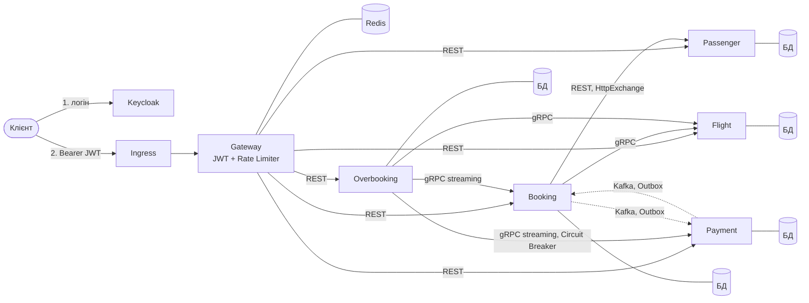

# Airline Booking System

Мікросервісна система продажу авіаквитків із динамічним ціноутворенням і контрольованим овербукінгом.

## Про що цей проєкт

Ціна квитка залежить від заповненості рейсу та кількості днів до вильоту: що вищий попит, то вища ціна. Паралельно система продає квитків трохи більше, ніж є фізичних місць, компенсуючи очікувану частку пасажирів, які не з'являться на рейс (no-show). Якщо в день вильоту підтверджених пасажирів виявляється більше, ніж місць, частина бронювань знімається з рейсу з грошовою компенсацією.

Бронювання — це розподілена транзакція, узгоджена за патерном SAGA: спершу резервується місце на рейсі, ціна фіксується як знімок стану на момент операції, а тоді списуються кошти. Якщо оплата відхилена, місце звільняється, а бронювання позначається як невдале — без "підвислих" резервацій. Оплата симулюється: реального руху коштів немає, а відмова виникає з невеликою заданою ймовірністю.

Детальний опис бізнес-сценаріїв, bounded contexts та обґрунтування архітектурних рішень — у [`docs/ARCHITECTURE_PROPOSAL.md`](./docs/ARCHITECTURE_PROPOSAL.md).

Опис розгортання системи в Kubernetes — у [`docs/KUBERNETES_REPORT.md`](./docs/KUBERNETES_REPORT.md).

Контракт подій, якими обмінюються `booking-service` і `payment-service` через Kafka, — у [`docs/EVENT_CONTRACT.md`](./docs/EVENT_CONTRACT.md).

## Архітектура



Кожен сервіс має власну БД. Токен видає Keycloak, перевіряє його шлюз (Resource Server), ліміт запитів рахує шлюз через Redis. Подробиці автентифікації — у [`docs/AUTH_GATEWAY.md`](./docs/AUTH_GATEWAY.md), колекція запитів — [`docs/airline-booking.postman_collection.json`](./docs/airline-booking.postman_collection.json).

Технології: Java 25, Spring Boot 4.1, Spring Cloud Gateway, Keycloak, gRPC (Protocol Buffers), Kafka, PostgreSQL, Resilience4j, Micrometer + Prometheus + Grafana, OpenTelemetry + Tempo + Loki, Kubernetes.

## Сервіси

Кожен сервіс — окремий, повністю самостійний застосунок зі своєю базою даних; спільної збірки чи спільної схеми між сервісами немає.

| Сервіс | Відповідальність |
|---|---|
| **Passenger Service** | Дані пасажирів та їхніх (емульованих) способів оплати |
| **Flight Service** | Рейси, місткість, розрахунок динамічної ціни |
| **Booking Service** | Оркестрація бронювання: резервація місця, фіксація ціни, ініціювання оплати |
| **Payment Service** | Симуляція оплати та повернень коштів |
| **Overbooking Resolution Service** | Перевірка рейсів перед вильотом, зняття бронювань за овербукінгом і компенсація |

## Запуск

Кожен сервіс збирається та запускається окремо, зі своєї власної папки:

```bash
cd flight-service
./gradlew bootRun
```

Аналогічно для `booking-service`, `passenger-service`, `payment-service`, `overbooking-service`.

## Kafka

Обмін подіями між `booking-service` і `payment-service` піднімається разом із брокером:

```bash
docker compose up -d --build kafka postgres-booking postgres-payment booking-service payment-service
```

Бронювання створюється через `POST http://localhost:8082/api/v1/bookings`, результат оплати видно через `GET http://localhost:8083/api/v1/payments?bookingId=<id>`. Топологія топіків і результати перевірки відмовостійкості описані в [`docs/KAFKA_REPORT.md`](./docs/KAFKA_REPORT.md).

## Команда

- Малій Олександра Михайлівна
- Говорищева Вероніка Максимівна
- Давиденко Георгій Андрійович

