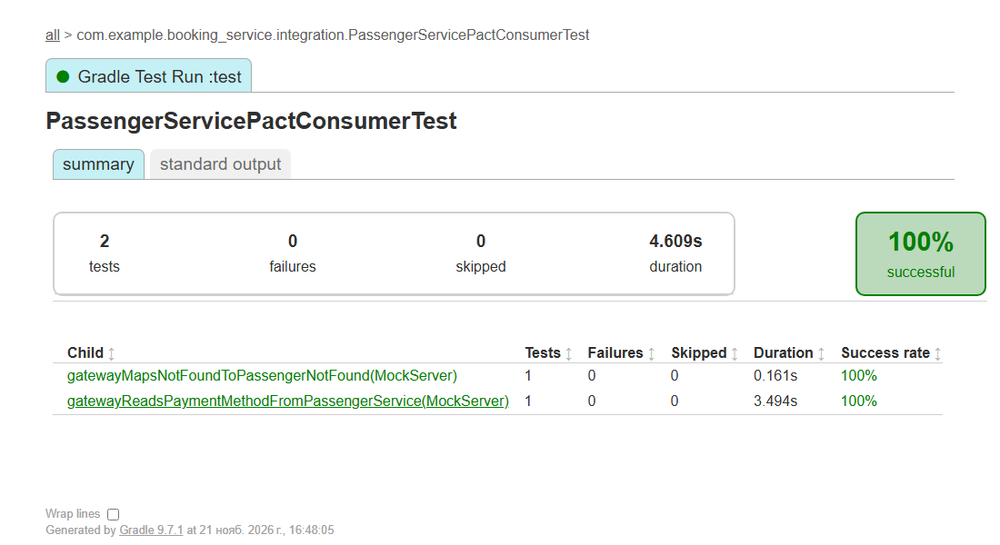
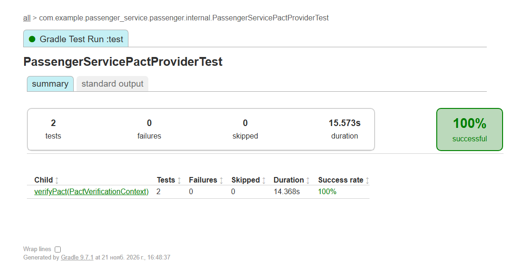
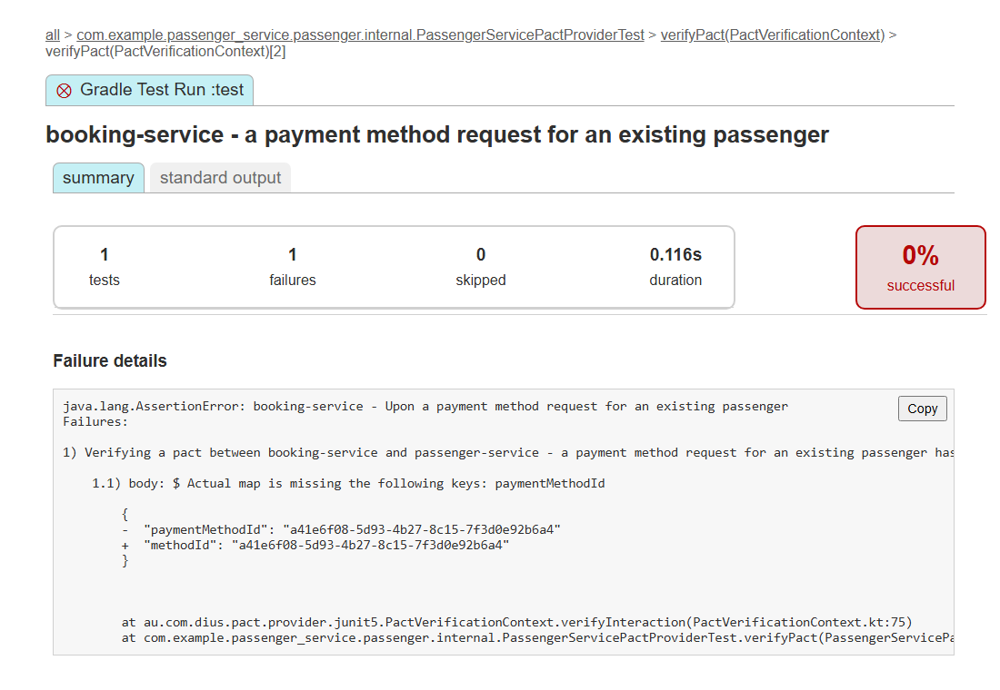
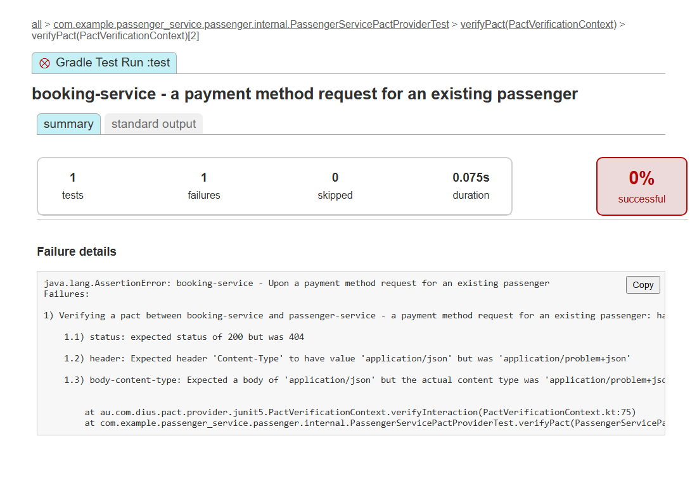
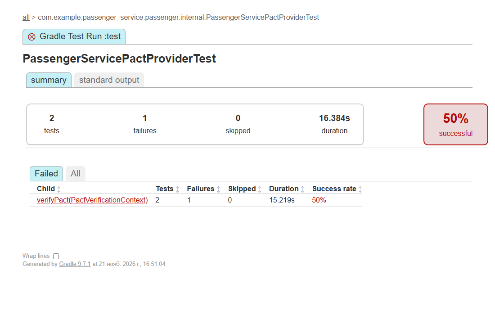

# Звіт: контрактне та навантажувальне тестування

## 1. Що ми зробили

Ми написали контрактний тест між `booking-service` і `passenger-service` за підходом Consumer-Driven Contracts на бібліотеці Pact, перевірили, що зміна контракту з будь-якого боку валить тест, і запустили три сценарії навантажувального тестування в k6 на справжньому стеку з `docker-compose.yml`.

## 2. Контрактний тест

### 2.1. Пара сервісів і схема

`booking-service` перед створенням бронювання питає в `passenger-service` платіжний метод пасажира: `GET /api/v1/passengers/{id}/payment-method`. Тому споживач `booking-service`, а постачальник `passenger-service`.

```
booking-service                      contracts/pacts                               passenger-service
PassengerServicePactConsumerTest ──► booking-service-passenger-service.json ──►  PassengerServicePactProviderTest
(пише контракт)                      (файл пакту)                                  (перевіряє контракт)
```

Файл контракту ми руками не пишемо. Його створює Pact, коли проходить тест споживача. Лежить він у теці `contracts/pacts` у корені репозиторію, обидва сервіси читають його звідти. Окремого Pact Broker у нас немає, тож ця тека виконує його роль.

Так виглядає одна взаємодія у створеному файлі `contracts/pacts/booking-service-passenger-service.json`: запит, стан постачальника `passenger exists` і відповідь з матчером для поля `paymentMethodId`.

```json
    {
      "comments": {
        "testname": "com.example.booking_service.integration.PassengerServicePactConsumerTest.gatewayReadsPaymentMethodFromPassengerService(MockServer)",
        "text": [

        ]
      },
      "description": "a payment method request for an existing passenger",
      "key": "a5cdd7c5",
      "pending": false,
      "providerStates": [
        {
          "name": "passenger exists",
          "params": {
            "passengerId": "3b7c1d5e-9f20-4c6a-b8d1-62e0a4f95c37",
            "paymentMethodId": "a41e6f08-5d93-4b27-8c15-7f3d0e92b6a4"
          }
        }
      ],
      "request": {
        "method": "GET",
        "path": "/api/v1/passengers/3b7c1d5e-9f20-4c6a-b8d1-62e0a4f95c37/payment-method"
      },
      "response": {
        "body": {
          "content": {
            "paymentMethodId": "a41e6f08-5d93-4b27-8c15-7f3d0e92b6a4"
          },
          "contentType": "application/json",
          "encoded": false
        },
        "headers": {
          "Content-Type": [
            "application/json"
          ]
        },
        "matchingRules": {
          "body": {
            "$.paymentMethodId": {
              "combine": "AND",
              "matchers": [
                {
                  "match": "regex",
                  "regex": "[0-9a-f]{8}-[0-9a-f]{4}-[0-9a-f]{4}-[0-9a-f]{4}-[0-9a-f]{12}"
                }
              ]
            }
          }
        },
        "status": 200
      },
      "transport": "http",
      "type": "Synchronous/HTTP"
    }
```

**Тест споживача** (`PassengerServicePactConsumerTest`, у `booking-service`) описує дві взаємодії. Pact піднімає мок-сервер, який вдає `passenger-service`, а справжній `PassengerGatewayImpl` з `PassengerClient` звертається до нього. Тест перевіряє, що `booking-service` правильно дістає `paymentMethodId` з відповіді і що 404 перетворюється на `PassengerNotFoundException`.

**Тест постачальника** (`PassengerServicePactProviderTest`, у `passenger-service`) піднімає справжній Spring Boot на випадковому порту. Pact бере кожну взаємодію з файлу, надсилає її запит на цей сервер і порівнює відповідь із записаною. `PassengerService` у цьому тесті замінений на Mockito-мок, тому перевіряється лише HTTP-шар: контролер, JSON і обробка помилок. Саму логіку сервісу й роботу з базою цей тест не покриває.

У контракті стан постачальника записаний назвою, наприклад `passenger exists`. У тесті постачальника для кожного стану є метод `@State`, який готує мок. Назви в обох місцях мають збігатися.

| Взаємодія | Стан | Запит | Відповідь |
|---|---|---|---|
| платіжний метод існуючого пасажира | `passenger exists` | `GET /api/v1/passengers/{id}/payment-method` | 200, `{"paymentMethodId": UUID}` |
| платіжний метод невідомого пасажира | `passenger does not exist` | той самий `GET` | 404 |

Значення в тілі описане матчером: `paymentMethodId` має відповідати формату UUID, а конкретне значення постачальник може повертати будь-яке. Тіло відповіді 404 (`application/problem+json`) у контракт не потрапило, бо `booking-service` його не читає.

Обидва тести проходять: споживач 2 з 2, постачальник 2 з 2 взаємодій.





### 2.2. Зміна контракту валить тест

Ми тричі змінювали код, запускали тест і повертали код назад. Повні логи лежать у `docs/test-evidence/`.

**Постачальник перейменував поле `paymentMethodId` на `methodId`** (`PaymentMethodDto` у `passenger-service`). Тест постачальника впав:

```
1) Verifying a pact between booking-service and passenger-service - a payment method request for an existing passenger has a matching body
   1.1) body: $ Actual map is missing the following keys: paymentMethodId
        {
        -  "paymentMethodId": "a41e6f08-5d93-4b27-8c15-7f3d0e92b6a4"
        +  "methodId": "a41e6f08-5d93-4b27-8c15-7f3d0e92b6a4"
        }
```




**Постачальник змінив адресу ендпоінта з `/payment-method` на `/payment-methods`** (`PassengerController`). Запит із контракту став отримувати 404 замість 200:

```
1) Verifying a pact between booking-service and passenger-service - a payment method request for an existing passenger: has status code 200
   1.1) status: expected status of 200 but was 404
   1.2) header: Expected header 'Content-Type' to have value 'application/json' but was 'application/problem+json'
   1.3) body-content-type: Expected a body of 'application/json' but the actual content type was 'application/problem+json'
```




У цьому експерименті впала лише одна з двох взаємодій. Обидві надсилають запит на стару адресу `/payment-method`, а її в сервісі більше немає, тому на будь-який такий запит Spring відповідає 404. Взаємодія «пасажир існує» чекає 200, отримує 404 і падає, і саме це показує, що ендпоінт зламано. Взаємодія «невідомий пасажир» чекає 404 і теж отримує 404, тому проходить, хоча причина інша: не «пасажира немає», а «такої адреси немає». Контракт це не розрізняє, бо для 404 у ньому записано лише код відповіді, без тіла. Зміна адреси все одно виявлена, адже перша взаємодія впала.

**Споживач змінив свої очікування: `paymentMethodId` став `methodId`** (`PaymentMethodResponse`, `PassengerGatewayImpl` і контракт у тесті). Тести споживача пройшли 2 з 2, бо мок відповідає тим, що споживач сам описав, а Pact перезаписав файл контракту. Тест постачальника з новим файлом упав:

```
1) Verifying a pact between booking-service and passenger-service - a payment method request for an existing passenger has a matching body
   1.1) body: $ Actual map is missing the following keys: methodId
        {
        -  "methodId": "a41e6f08-5d93-4b27-8c15-7f3d0e92b6a4"
        +  "paymentMethodId": "a41e6f08-5d93-4b27-8c15-7f3d0e92b6a4"
        }
```





Так працює CDC: споживач не може змінити свої вимоги непомітно для постачальника.

## 3. Навантажувальне тестування

Тестували k6 v2.4.0 у Docker, у мережі compose. Стек з `docker-compose.yml` (`flight`, `passenger`, `booking`, `payment`, чотири PostgreSQL, Kafka), образи зібрані з `main`. Машина: Windows 11, 12 процесорів, 16 ГБ для Docker. Генератор навантаження й усі сервіси працюють на одній машині без обмежень ресурсів, тому цифри орієнтовні. Скрипти лежать у `load-tests/`, результати в `load-tests/results/`.

### 3.1. Сценарії

| № | Що навантажуємо | Модель | Профіль | Пороги |
|---|---|---|---|---|
| 1 | `GET /flights/{id}/price` у `flight-service` (читання) | закрита, `ramping-vus` | до 50 VU, 60 с на піку, пауза 100 мс | p95 < 300 мс, помилок < 1% |
| 2 | `POST` резервування і `DELETE` скасування в `flight-service` (запис) | відкрита, `constant-arrival-rate` | 100 ітерацій/с, 60 с | p95 < 500 мс, помилок < 1%, без пропущених ітерацій |
| 3 | `POST /bookings` у `booking-service` (наскрізний ланцюжок: gRPC до `flight`, REST до `passenger`, база, Kafka) | відкрита, `ramping-arrival-rate` | 20 запитів/с, потім пік (60, 120, 200 або 300/с, змінна `PEAK_RATE`), 60 с на піку | p95 < 2 с, помилок < 5% |

Сценарії 2 і 3 відкриті: запити йдуть за графіком, навіть коли сервер відповідає повільно. У закритій моделі повільні відповіді зменшують кількість запитів і затримки виглядають кращими, ніж є (Coordinated Omission).

### 3.2. Результати

Помилок у всіх запусках 0%, усі перевірки пройшли. «Запитів» це всі HTTP-запити прогону, включно із запитами `setup()` (у сценарії 1 один, у сценарії 2 десять, у сценарії 3 двадцять один). RPS це кількість запитів, поділена на тривалість прогону, тобто середнє за весь прогін, включно з підйомом і спадом. Обидва числа взяті з рядка `http_reqs` у виведенні k6.

| Запуск | Запитів | RPS | p50 | p95 | max | Пропущено ітерацій | Пороги |
|---|---|---|---|---|---|---|---|
| 1. Ціна, до 50 VU | 35 319 | 392,2 | 3,2 мс | 12,5 мс | 210 мс | 0 | пройдено |
| 2. Резервування і скасування | 12 012 | 199,8 | 5,4 мс | 26,2 мс | 1,08 с | 0 | пройдено |
| 3. Бронювання, пік 60/с | 6 995 | 34,9 | 25,6 мс | 59,8 мс | 524 мс | 0 | пройдено |
| 3. Бронювання, пік 120/с | 12 064 | 60,4 | 36,2 мс | 746 мс | 2,3 с | 31 | пройдено |
| 3. Бронювання, пік 200/с | 17 196 | 84,3 | 1,60 с | 10,9 с | 15,4 с | 1 699 | p95 не пройдено |
| 3. Бронювання, пік 300/с | 20 352 | 99,3 | 8,5 с | 12,2 с | 14,5 с | 7 043 | p95 не пройдено |

Нижче вибрані рядки з виведення k6 (порогові перевірки та показники HTTP і виконання). Повні логи лежать у `load-tests/results/*.log`.

Сценарій 1, читання ціни (`load-tests/results/01-price-read-ramp.log`):

```
  █ THRESHOLDS 
    checks
    ✓ 'rate>0.99' rate=100.00%
    http_req_duration
    ✓ 'p(95)<300' p(95)=12.53ms
    http_req_failed
    ✓ 'rate<0.01' rate=0.00%

  █ TOTAL RESULTS
    HTTP
    http_req_duration..............: avg=5.05ms   min=1.16ms   med=3.21ms   max=210.06ms p(90)=8ms      p(95)=12.53ms
    http_req_failed................: 0.00%  0 out of 35319
    http_reqs......................: 35319  392.156333/s
    EXECUTION
    iterations.....................: 35318  392.145229/s
    vus_max........................: 50     min=50         max=50
```

Сценарій 2, резервування і скасування (`load-tests/results/02-seat-reservation-constant-rate.log`):

```
  █ THRESHOLDS 
    checks
    ✓ 'rate>0.99' rate=100.00%
    dropped_iterations
    ✓ 'count<1' count=0
    http_req_duration{name:DELETE /reservations/{id}}
    ✓ 'p(95)<500' p(95)=24.77ms
    http_req_duration{name:POST /flights/{id}/reservations}
    ✓ 'p(95)<500' p(95)=27.49ms
    http_req_failed
    ✓ 'rate<0.01' rate=0.00%

  █ TOTAL RESULTS
    HTTP
    http_req_duration............................: avg=14.44ms min=1.99ms med=5.37ms  max=1.08s    p(90)=9.73ms  p(95)=26.16ms
    http_req_failed..............................: 0.00%  0 out of 12012
    http_reqs....................................: 12012  199.779825/s
    EXECUTION
    dropped_iterations...........................: 0      0/s
    iterations...................................: 6001   99.806754/s
    vus_max......................................: 100    min=100        max=100
```

Сценарій 3, бронювання, пік 60/с (`load-tests/results/03-booking-e2e-stress-peak60.log`):

```
  █ THRESHOLDS 
    checks
    ✓ 'rate>0.95' rate=100.00%
    http_req_duration
    ✓ 'p(95)<2000' p(95)=59.81ms
    http_req_failed
    ✓ 'rate<0.05' rate=0.00%

  █ TOTAL RESULTS
    HTTP
    http_req_duration..............: avg=35.36ms min=6.96ms  med=25.62ms max=524.35ms p(90)=36.09ms p(95)=59.81ms
    http_req_failed................: 0.00%  0 out of 6995
    http_reqs......................: 6995   34.930919/s
    EXECUTION
    iterations.....................: 6974   34.826051/s
    vus_max........................: 100    min=100       max=100
```

Сценарій 3, бронювання, пік 120/с (`load-tests/results/03-booking-e2e-stress-peak120.log`):

```
  █ THRESHOLDS 
    checks
    ✓ 'rate>0.95' rate=100.00%
    http_req_duration
    ✓ 'p(95)<2000' p(95)=746.07ms
    http_req_failed
    ✓ 'rate<0.05' rate=0.00%

  █ TOTAL RESULTS
    HTTP
    http_req_duration..............: avg=168.45ms min=6.96ms  med=36.16ms max=2.27s p(90)=526ms    p(95)=746.07ms
    http_req_failed................: 0.00%  0 out of 12064
    http_reqs......................: 12064  60.429806/s
    EXECUTION
    dropped_iterations.............: 31     0.155282/s
    iterations.....................: 12043  60.324615/s
    vus_max........................: 124    min=100        max=124
```

Сценарій 3, бронювання, пік 200/с (`load-tests/results/03-booking-e2e-stress-peak200.log`):

```
  █ THRESHOLDS 
    checks
    ✓ 'rate>0.95' rate=100.00%
    http_req_duration
    ✗ 'p(95)<2000' p(95)=10.87s
    http_req_failed
    ✓ 'rate<0.05' rate=0.00%

  █ TOTAL RESULTS
    HTTP
    http_req_duration..............: avg=3.05s min=7.59ms  med=1.59s max=15.42s p(90)=9.5s p(95)=10.87s
    http_req_failed................: 0.00%  0 out of 17196
    http_reqs......................: 17196  84.333355/s
    EXECUTION
    dropped_iterations.............: 1699   8.332308/s
    iterations.....................: 17175  84.230366/s
    vus_max........................: 1336   min=100        max=1336
```

Сценарій 3, бронювання, пік 300/с (`load-tests/results/03-booking-e2e-stress-peak300.log`):

```
  █ THRESHOLDS 
    checks
    ✓ 'rate>0.95' rate=100.00%
    http_req_duration
    ✗ 'p(95)<2000' p(95)=12.15s
    http_req_failed
    ✓ 'rate<0.05' rate=0.00%

  █ TOTAL RESULTS
    HTTP
    http_req_duration..............: avg=6.97s min=9.96ms  med=8.49s max=14.47s p(90)=11.99s p(95)=12.15s
    http_req_failed................: 0.00%  0 out of 20352
    http_reqs......................: 20352  99.336158/s
    EXECUTION
    dropped_iterations.............: 7043   34.376207/s
    iterations.....................: 20331  99.233659/s
    vus_max........................: 2000   min=100        max=2000
```

### 3.3. Висновки

- Читання й запис у `flight-service` тримають навантаження з запасом: p95 у десятках мілісекунд.
- Бронювання стабільне при піку 60/с. З 120/с p95 росте до сотень мілісекунд і з'являються пропущені ітерації, а при 200 і 300/с поріг p95 не проходить. Середній RPS не росте вище приблизно 100, навіть коли запланований пік 300: це і є точка насичення. Вона лежить між піками 60 і 120/с, а в таблиці по одному прогону на кожну конфігурацію, тому межа орієнтовна і не враховує розкид між прогонами.
- Помилок немає. Після насичення сервіс не відмовляє, а ставить запити в чергу, тому проблему видно лише по p95 і пропущених ітераціях.
- За `docker stats` жоден сервіс не використав більше за близько 2,2 ядра з 12, тож обмежує, схоже, не процесор. Можливо, послідовні синхронні виклики в `booking-service` або розміри пулів, але ми це не перевіряли.
- Ми міряли p50, p90, p95 і max. Відсоток p99 k6 за замовчуванням не рахує, і ми його не додавали.

## 4. Як відтворити

Контрактні тести, з кореня репозиторію:

```powershell
cd booking-service
.\gradlew.bat test --tests "*PassengerServicePactConsumerTest"
cd ..\passenger-service
.\gradlew.bat test --tests "*PassengerServicePactProviderTest"
```

Спершу має пройти тест споживача, бо він створює `contracts/pacts/booking-service-passenger-service.json`. Потім тест постачальника перевіряє цей файл.

Навантажувальні тести. У `booking-service/.env` має бути рядок `FLIGHT_GRPC_TARGET=flight-service:9081` (є в `.env.example`):

```powershell
docker compose up -d kafka postgres-flight postgres-passenger postgres-booking postgres-payment flight-service passenger-service booking-service payment-service
bash load-tests/run-scenario.sh 01-price-read-ramp
bash load-tests/run-scenario.sh 02-seat-reservation-constant-rate
$env:PEAK_RATE=120; bash load-tests/run-scenario.sh 03-booking-e2e-stress 03-booking-e2e-stress-peak120
```

На Windows з JDK 25 Gradle у нас падав з помилкою `Unable to establish loopback connection`. Допомогло вказати коротку теку для unix-сокетів: `$env:JAVA_TOOL_OPTIONS="-Djdk.net.unixdomain.tmpdir=C:/jtmp"` (тека має існувати).

## 5. Файли

| Що | Де |
|---|---|
| Тест споживача | `booking-service/src/test/java/com/example/booking_service/integration/PassengerServicePactConsumerTest.java` |
| Тест постачальника | `passenger-service/src/test/java/com/example/passenger_service/passenger/internal/PassengerServicePactProviderTest.java` |
| Файл контракту | `contracts/pacts/booking-service-passenger-service.json` |
| Залежності Pact 4.7.7 | `booking-service/build.gradle`, `passenger-service/build.gradle` |
| Скрипти k6 | `load-tests/*.js`, `load-tests/lib/seed.js`, `load-tests/run-scenario.sh` |
| Результати k6 | `load-tests/results/` |
| Логи експериментів з контрактом | `docs/test-evidence/` |
