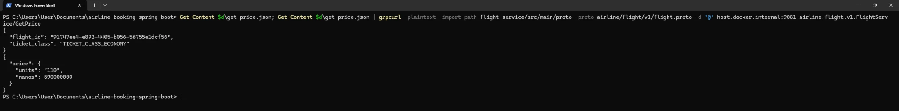
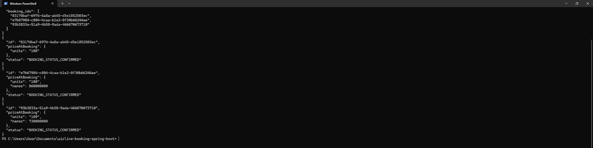
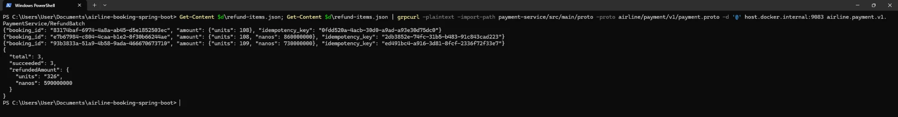
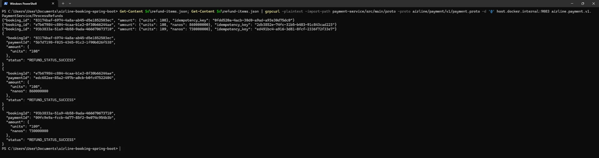

# Звіт: взаємодія сервісів через gRPC

## 1. Що зроблено

- Чотири сервіси переведено на Java 25, додано залежності Spring gRPC і спільні контракти `.proto`: `FlightService`, `BookingService`, `PaymentService`, тип `Money`.
- `flight-service`, `booking-service` і `payment-service` отримали gRPC-сервери на портах 9081, 9082 і 9083 поряд із наявним REST.
- Внутрішні виклики між сервісами замінено з REST на gRPC: `booking-service` звертається до `flight-service`, `overbooking-service` до `booking-service` і `payment-service`. REST-клієнти та WireMock-тести для цих зв'язків прибрано.
- Реалізовано всі чотири типи викликів: Unary, Server streaming, Client streaming і Bidirectional streaming.
- Повтори налаштовано на рівні gRPC-каналів через `service-config`; Resilience4j Retry в `overbooking-service` прибрано, Circuit Breaker і Bulkhead лишились.
- У серверах є інтерсептор імітації збою, яким перевірено повтори на запущеній системі.
- Порти gRPC опубліковано в `docker-compose.yml` і в Kubernetes, NetworkPolicy дозволяє їх лише для тих пар сервісів, які справді спілкуються.

| Вимога | Де доведено |
|---|---|
| Усі чотири типи викликів gRPC | розділи 2 і 4 |
| Повтори з поясненням конфігурації | розділ 3 |
| Три спроби, потім успіх | розділ 5, R1 |
| Усі спроби невдалі, результат для користувача | розділ 5, R2 |
| Виклик, що змінює стан, не повторюється | розділ 5, R3 |
| Тести повторів і кількість тестів | розділ 6 |

Перевірку проведено в `docker compose` на збірці, яка містить усі зміни gRPC з issues #96 до #102.

## 2. Схема викликів

```
клієнт (REST)
   |
booking-service  ----gRPC 9081---->  flight-service
   POST /api/v1/bookings                GetPrice, ReserveSeat, ReleaseSeat

overbooking-service  --gRPC 9082-->  booking-service
   POST /api/v1/overbooking/compensations          StreamBookings
   POST /api/v1/overbooking/compensations/summary

overbooking-service  --gRPC 9083-->  payment-service
                                        ProcessRefunds, RefundBatch
```

| Виклик | Тип | Клієнт | Сервер | Повтори |
|---|---|---|---|---|
| `GetPrice` | Unary | `booking-service` | `flight-service:9081` | так |
| `ReserveSeat` | Unary | `booking-service` | `flight-service:9081` | ні |
| `ReleaseSeat` | Unary | `booking-service` | `flight-service:9081` | ні |
| `StreamBookings` | Server streaming | `overbooking-service` | `booking-service:9082` | так |
| `RefundBatch` | Client streaming | `overbooking-service` | `payment-service:9083` | так |
| `ProcessRefunds` | Bidirectional streaming | `overbooking-service` | `payment-service:9083` | так |

Публічний REST не змінився: `POST /api/v1/bookings` і `POST /api/v1/overbooking/compensations` мають ті самі запити й відповіді, що й раніше. Новий лише `POST /api/v1/overbooking/compensations/summary`, який повертає підсумок `total`, `succeeded`, `declined`, `refundedAmount`.

## 3. Конфігурація повторів

Повтори задано у властивостях каналів, без коду. Приклад для каналу `payment` в `overbooking-service`:

```properties
spring.grpc.client.channel.payment.target=${PAYMENT_GRPC_TARGET:localhost:9083}
spring.grpc.client.channel.payment.default.deadline=10s
spring.grpc.client.channel.payment.service-config.method[0].name[0].service=airline.payment.v1.PaymentService
spring.grpc.client.channel.payment.service-config.method[0].name[0].method=ProcessRefunds
spring.grpc.client.channel.payment.service-config.method[0].name[1].service=airline.payment.v1.PaymentService
spring.grpc.client.channel.payment.service-config.method[0].name[1].method=RefundBatch
spring.grpc.client.channel.payment.service-config.method[0].retry.max-attempts=3
spring.grpc.client.channel.payment.service-config.method[0].retry.initial-backoff=100ms
spring.grpc.client.channel.payment.service-config.method[0].retry.max-backoff=1s
spring.grpc.client.channel.payment.service-config.method[0].retry.backoff-multiplier=2
spring.grpc.client.channel.payment.service-config.method[0].retry.retryable-status-codes=UNAVAILABLE
```

| Параметр | Значення | Пояснення |
|---|---|---|
| `target` | змінні `FLIGHT_GRPC_TARGET`, `BOOKING_GRPC_TARGET`, `PAYMENT_GRPC_TARGET` | адреса сервера у форматі `host:port` |
| `default.deadline` | 3 с для `flight`, 10 с для `booking` і `payment` | загальний час на виклик разом з усіма повторами |
| `max-attempts` | 3 | перша спроба і два повтори |
| `initial-backoff`, `backoff-multiplier`, `max-backoff` | 100 мс, 2, 1 с | пауза близько 100 мс перед другою спробою і близько 200 мс перед третьою |
| `retryable-status-codes` | `UNAVAILABLE` | повторюється лише недоступність сервера; `NOT_FOUND`, `INVALID_ARGUMENT`, `FAILED_PRECONDITION` повертаються одразу |

Канали та методи з повторами:

| Канал | Сервіс-клієнт | Методи з повторами |
|---|---|---|
| `flight` | `booking-service` | `GetPrice` |
| `booking` | `overbooking-service` | `StreamBookings` |
| `payment` | `overbooking-service` | `ProcessRefunds`, `RefundBatch` |

`ReserveSeat` і `ReleaseSeat` у конфігурації повторів немає, бо вони змінюють стан. Якщо відповідь на `ReserveSeat` загубилась, клієнт не знає, чи місце вже зарезервоване, і повтор міг би зайняти друге місце. Тому помилка повертається одразу, а бронювання компенсується звичайним шляхом. `GetPrice` лише читає дані, а повернення коштів захищене ключем ідемпотентності, тому їх повторювати безпечно.

Для потокових викликів gRPC повторює спробу лише доки сервер не надіслав жодного повідомлення у відповідь. Якщо потік обірвався посередині, `overbooking-service` зберігає результати, які вже прийшли, а решту бронювань повертає зі статусом `PENDING`.

## 4. Чотири типи викликів

Кожен тип викликано напряму через `grpcurl` з імпортом `.proto`. `grpcurl` запускався з образу `fullstorydev/grpcurl`, тому адреса сервера на скріншотах `host.docker.internal`, а тіло запиту читається з файлу й передається через стандартний ввід (`-d '@'`):

```powershell
function grpcurl { $input | docker run --rm -i -v "${PWD}:/work" -w /work fullstorydev/grpcurl @args }
```

Дані для викликів: один рейс і три підтверджені бронювання з цінами 108, 108.86 і 109.73 (ціна зростає разом із заповненістю рейсу).

### 4.1. Unary: `GetPrice`

Один запит, одна відповідь. Цей виклик робить `booking-service` під час `POST /api/v1/bookings`, разом із `ReserveSeat`.

```powershell
Get-Content $d\get-price.json | grpcurl -plaintext -import-path flight-service/src/main/proto -proto airline/flight/v1/flight.proto -d '@' host.docker.internal:9081 airline.flight.v1.FlightService/GetPrice
```

Відповідь: ціна наступного місця 110.59 у вигляді `Money` (`units: 110`, `nanos: 590000000`).



### 4.2. Server streaming: `StreamBookings`

Один запит зі списком id, у відповідь потік: по одному повідомленню `Booking` на кожне знайдене бронювання. Відсутні бронювання в потік не потрапляють, і `overbooking-service` у такому разі відповідає `404` з переліком відсутніх id.

```powershell
Get-Content $d\stream-bookings.json | grpcurl -plaintext -import-path booking-service/src/main/proto -proto airline/booking/v1/booking.proto -d '@' host.docker.internal:9082 airline.booking.v1.BookingService/StreamBookings
```

На скріншоті тіло запиту з трьома id і три повідомлення у відповідь зі статусом `BOOKING_STATUS_CONFIRMED`.



### 4.3. Client streaming: `RefundBatch`

Клієнт надсилає потік із трьох `RefundItem` і отримує один `RefundSummary`.

```powershell
Get-Content $d\refund-items.json | grpcurl -plaintext -import-path payment-service/src/main/proto -proto airline/payment/v1/payment.proto -d '@' host.docker.internal:9083 airline.payment.v1.PaymentService/RefundBatch
```

Відповідь: `total: 3`, `succeeded: 3`, сума повернень 326.59. Поле `declined` у виводі відсутнє, бо дорівнює нулю, а proto3 не друкує значення за замовчуванням.

Той самий виклик через REST, `POST /api/v1/overbooking/compensations/summary`, повернув:

```json
{ "total": 3, "succeeded": 3, "declined": 0, "refundedAmount": 326.59 }
```



### 4.4. Bidirectional streaming: `ProcessRefunds`

Клієнт надсилає потік `RefundItem`, сервер на кожен одразу відповідає `RefundResult`, порядок відповідей збігається з порядком запитів.

```powershell
Get-Content $d\refund-items.json | grpcurl -plaintext -import-path payment-service/src/main/proto -proto airline/payment/v1/payment.proto -d '@' host.docker.internal:9083 airline.payment.v1.PaymentService/ProcessRefunds
```

Той самий виклик через REST, `POST /api/v1/overbooking/compensations`, повернув:

```json
[
  { "bookingId": "83174baf-6974-4a8a-ab45-d5e1852503ec", "amount": 108, "status": "COMPLETED" },
  { "bookingId": "e7b67984-c804-4caa-b1e2-8f30b66244ae", "amount": 108.86, "status": "COMPLETED" },
  { "bookingId": "93b3833a-51a9-4b58-9ada-466670673710", "amount": 109.73, "status": "COMPLETED" }
]
```



`RefundBatch` і `ProcessRefunds` викликано для тих самих бронювань з тими самими ключами ідемпотентності, що й компенсація через REST. Після всіх викликів у `payment-service` для кожного бронювання лишився один платіж `CHARGE` і один `REFUND`: повтори не створили нових платежів.

## 5. Експерименти з відмовою

Збій імітує інтерсептор на сервері: перші N викликів методу завершуються статусом `UNAVAILABLE`, кожна спроба логується. Властивості: `flight.grpc.failures-before-success`, `booking.grpc.failures-before-success`, `payment.grpc.failures-before-success` (за замовчуванням `0`). У `docker compose` вони задавались змінними `FLIGHT_GRPC_FAILURES_BEFORE_SUCCESS` і `PAYMENT_GRPC_FAILURES_BEFORE_SUCCESS`.

### R1. Два збої, третя спроба успішна

Значення `2` для `flight-service` і `payment-service`. Виконано бронювання, компенсацію і підсумок.

```
13:35:49.104 flight-service  WARN | GetPrice attempt 1: UNAVAILABLE (simulated)
13:35:49.204 flight-service  WARN | GetPrice attempt 2: UNAVAILABLE (simulated)
13:35:49.395 flight-service  INFO | GetPrice attempt 3: accepted
13:35:53.803 payment-service WARN | ProcessRefunds attempt 1: UNAVAILABLE (simulated)
13:35:53.929 payment-service WARN | ProcessRefunds attempt 2: UNAVAILABLE (simulated)
13:35:54.139 payment-service INFO | ProcessRefunds attempt 3: accepted
13:35:54.192 payment-service WARN | RefundBatch attempt 1: UNAVAILABLE (simulated)
13:35:54.291 payment-service WARN | RefundBatch attempt 2: UNAVAILABLE (simulated)
13:35:54.463 payment-service INFO | RefundBatch attempt 3: accepted
```

Проміжки між спробами близько 100 і 200 мс, як задано в конфігурації. Користувач збою не помітив:

| Запит | Відповідь |
|---|---|
| `POST /api/v1/bookings` | `201`, статус `SEAT_RESERVED`, 684 мс |
| `POST /api/v1/overbooking/compensations` | `200`, статус `COMPLETED`, 497 мс |
| `POST /api/v1/overbooking/compensations/summary` | `200`, `total = 1`, 294 мс |

### R2. Усі спроби невдалі

Значення `1000` для обох сервісів.

```
13:36:58.211 flight-service      WARN | GetPrice attempt 4: UNAVAILABLE (simulated)
13:36:58.310 flight-service      WARN | GetPrice attempt 5: UNAVAILABLE (simulated)
13:36:58.534 flight-service      WARN | GetPrice attempt 6: UNAVAILABLE (simulated)
13:36:58.653 payment-service     WARN | ProcessRefunds attempt 1: UNAVAILABLE (simulated)
13:36:58.750 payment-service     WARN | ProcessRefunds attempt 2: UNAVAILABLE (simulated)
13:36:58.933 payment-service     WARN | ProcessRefunds attempt 3: UNAVAILABLE (simulated)
13:36:58.934 overbooking-service WARN | Refunds deferred: ... UNAVAILABLE: Simulated failure, attempt 3
13:36:58.947 payment-service     WARN | RefundBatch attempt 1: UNAVAILABLE (simulated)
13:36:59.061 payment-service     WARN | RefundBatch attempt 2: UNAVAILABLE (simulated)
13:36:59.253 payment-service     WARN | RefundBatch attempt 3: UNAVAILABLE (simulated)
13:36:59.255 overbooking-service WARN | Dependency unavailable: io.grpc.StatusRuntimeException: UNAVAILABLE: Simulated failure, attempt 3
```

Лічильник `GetPrice` показує спроби 4, 5 і 6, бо це другий запит до того самого екземпляра сервісу; на кожен запит припадає рівно три спроби.

| Запит | Спроб | Результат для користувача |
|---|---|---|
| `POST /api/v1/bookings` | 3 × `GetPrice` | `503`, «Не вдалося оформити бронювання, спробуйте пізніше» |
| `POST /api/v1/overbooking/compensations` | 3 × `ProcessRefunds` | `200`, бронювання зі статусом `PENDING` |
| `POST /api/v1/overbooking/compensations/summary` | 3 × `RefundBatch` | `503`, «Необхідний зовнішній сервіс тимчасово недоступний» |

Компенсація повертає `PENDING`, а не помилку, бо виплату можна відкласти; підсумок без даних не має сенсу, тому там `503`.

Спостереження під час запуску: одразу після перестворення контейнера `payment-service` перший виклик завершився `UNAVAILABLE: io exception` ще до інтерсептора, бо канал клієнта тримав стару адресу контейнера. Результат для користувача той самий (`PENDING` і `503`), а за кілька секунд канал підключився до нової адреси.

### R3. `ReserveSeat` при `UNAVAILABLE` виконується один раз

Інтерсептор у `flight-service` імітує збій лише для `GetPrice`, тому на запущеній системі отримати `UNAVAILABLE` саме від `ReserveSeat` неможливо. Цей випадок перевірено тестом `FlightGatewayGrpcTest` у `booking-service`: підставний gRPC-сервер на окремому порту завжди відповідає `UNAVAILABLE`, а канал має ту саму конфігурацію повторів, що й у роботі.

```
FlightGatewayGrpcTest > getPriceIsRetriedAfterTwoUnavailableResponses() PASSED
FlightGatewayGrpcTest > getPriceGivesUpAfterThreeAttempts() PASSED
FlightGatewayGrpcTest > reserveSeatIsNeverRetried() PASSED
```

`reserveSeatIsNeverRetried` перевіряє, що сервер отримав рівно один виклик `ReserveSeat`, тоді як `GetPrice` у тих самих умовах отримує три.

## 6. Тести

Усі тести gRPC працюють зі справжнім транспортом: сервер піднімається на випадковому порту, клієнт підключається через канал із робочою конфігурацією повторів.

| Сервіс | Тестів усього | Тести gRPC | Що перевіряють |
|---|---|---|---|
| `flight-service` | 57 | `FlightGrpcServiceTest` (8), `FlightGrpcFailureSimulationTest` (1) | успіх трьох методів, `NOT_FOUND`, `FAILED_PRECONDITION`, `INVALID_ARGUMENT`; два збої й успіх з третього виклику |
| `booking-service` | 79 | `BookingGrpcServiceTest` (5), `BookingGrpcFailureSimulationTest` (1), `FlightGatewayGrpcTest` (8) | потік із трьох бронювань, відсутнє бронювання, порожній список; повтори `GetPrice` (3 виклики), відмова після 3 спроб, 1 виклик `ReserveSeat` |
| `payment-service` | 54 | `PaymentGrpcServiceTest` (5), `PaymentGrpcFailureSimulationTest` (2) | `RefundBatch` і `ProcessRefunds`, ключ ідемпотентності з повідомлення доходить до сервісу, некоректні сума та id дають `INVALID_ARGUMENT`; імітація збою для обох методів |
| `overbooking-service` | 39 | `CompensationGrpcTest` (13) | повний шлях компенсації й підсумку, `404`, `503`, повтори, Circuit Breaker |

У кожному з чотирьох сервісів є ще `MoneyMapperTest` (11 тестів) на перетворення `BigDecimal` у `Money` і назад.

Тести повторів у `CompensationGrpcTest`:

| Тест | Умова | Очікування |
|---|---|---|
| `bookingStreamIsRetriedAfterTwoUnavailableResponses` | `StreamBookings` двічі `UNAVAILABLE` | відповідь `200`, 3 виклики |
| `unavailableBookingServiceReturns503AfterThreeAttempts` | `StreamBookings` завжди `UNAVAILABLE` | `503`, 3 виклики, повернення коштів не починалось |
| `refundStreamIsRetriedAfterTwoUnavailableResponses` | `ProcessRefunds` двічі `UNAVAILABLE` | `COMPLETED`, 3 виклики, той самий ключ ідемпотентності |
| `refundsStayPendingWhenPaymentServiceIsUnavailable` | `ProcessRefunds` завжди `UNAVAILABLE` | усі `PENDING`, 3 виклики |
| `resultsReceivedBeforeStreamFailureAreKept` | потік обривається після першої відповіді | перше бронювання `COMPLETED`, решта `PENDING` |
| `refundBatchIsRetriedAfterTwoUnavailableResponses` | `RefundBatch` двічі `UNAVAILABLE` | підсумок отримано, 3 виклики |
| `summaryReturns503WhenPaymentServiceIsUnavailable` | `RefundBatch` завжди `UNAVAILABLE` | `503`, 3 виклики |
| `errorStormOpensCircuitAndStopsCallingPaymentService` | 10 невдалих компенсацій поспіль | Circuit Breaker у стані `OPEN`, одинадцятий запит до сервера не доходить |

## 7. Архів

Архів для здачі містить код чотирьох сервісів із контрактами `.proto`, `docker-compose.yml`, маніфести `k8s/`, цей звіт і скріншоти `docs/screenshots/grpc-*.png`.
