# Звіт: обмін подіями через Kafka

## 1. Що зроблено

- Kafka у режимі KRaft у `docker-compose.yml`; автостворення топіків у брокері вимкнено, топіки створюють їхні продюсери через `NewTopic` і `TopicBuilder`.
- Контракт подій `BookingReservedEvent` і `PaymentProcessedEvent` описаний у [`EVENT_CONTRACT.md`](./EVENT_CONTRACT.md), кожен сервіс має власну копію record.
- `booking-service` зберігає бронювання та запис `outbox` в одній транзакції, `PollingOutboxScheduler` публікує подію в `booking-events`.
- `payment-service` споживає `booking-events`: Idempotent Consumer через `processed_events`, ретраї через `@RetryableTopic`, Dead Letter Topic. Результат оплати публікується в `payment-events` через власний Outbox.
- `booking-service` споживає `payment-events`: `SUCCESS` дає `CONFIRMED`, `DECLINED` і `FAILED` звільняють місце й дають `FAILED` (SAGA-компенсація).
- Перевірено: атомарність запису сутності й події, перехід події в DLT, відсутність дублювання бізнес-ефектів при відмові споживача.

| Вимога | Де доведено |
|---|---|
| Узгоджені схеми подій і працююча конфігурація | [`EVENT_CONTRACT.md`](./EVENT_CONTRACT.md), розділ 2 |
| Усунення подвійного запису завдяки єдиному `TransactionManager` | розділ 3 |
| Інтеграційний тест `@EmbeddedKafka`, перехід події в DLT | розділ 4 |
| Експеримент зі штучною відмовою споживача | розділ 5 |
| Топологія топіків | розділ 2 |

## 2. Топологія топіків

```
booking-service                                             payment-service
 POST /api/v1/bookings
  └─ bookings + outbox (одна транзакція)
      └─ PollingOutboxScheduler ──▶ booking-events ──▶ BookingReservedListener
                                                         payments + processed_events + outbox (одна транзакція)
 PaymentProcessedListener ◀── payment-events ◀── OutboxRelay
  CONFIRMED / FAILED + releaseSeat
```

| Топік | Продюсер | Споживач | Партиції | Ключ | Група | Retry-топіки | DLT |
|---|---|---|---|---|---|---|---|
| `booking-events` | `booking-service` | `payment-service` | 3 | `bookingId` | `payment-service-group` | `booking-events-retry-1000`, `booking-events-retry-2000` | `booking-events-dlt` |
| `payment-events` | `payment-service` | `booking-service` | 3 | `bookingId` | `booking-service-group` | `payment-events-retry-1000`, `payment-events-retry-2000` | `payment-events-dlt` |

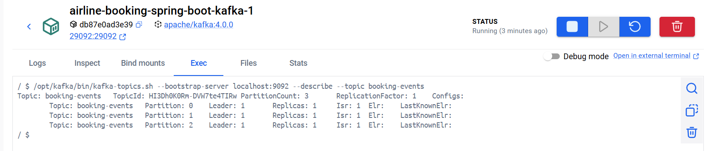


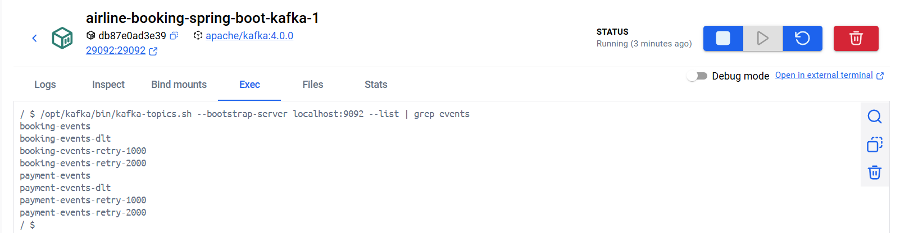

## 3. Атомарність запису сутності та події

Збій запису в `outbox` змодельований обмеженням у БД: `ALTER TABLE outbox ADD CONSTRAINT demo_no_insert CHECK (false) NOT VALID;`

| Сценарій | Відповідь | `bookings` | `outbox` |
|---|---|---|---|
| Успіх | `201` | рядок бронювання (після обробки оплати `CONFIRMED`) | рядок `BookingReserved`, `processed=true` |
| Збій запису в `outbox` | `503` | `FAILED`, `price_at_booking` і `reservation_id` порожні | 0 рядків для цього бронювання |

Бронювання не залишається в `SEAT_RESERVED` без події: оновлення бронювання й запис у `outbox` відкочуються разом.

Успіх:

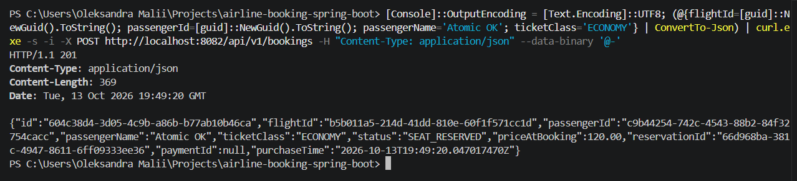

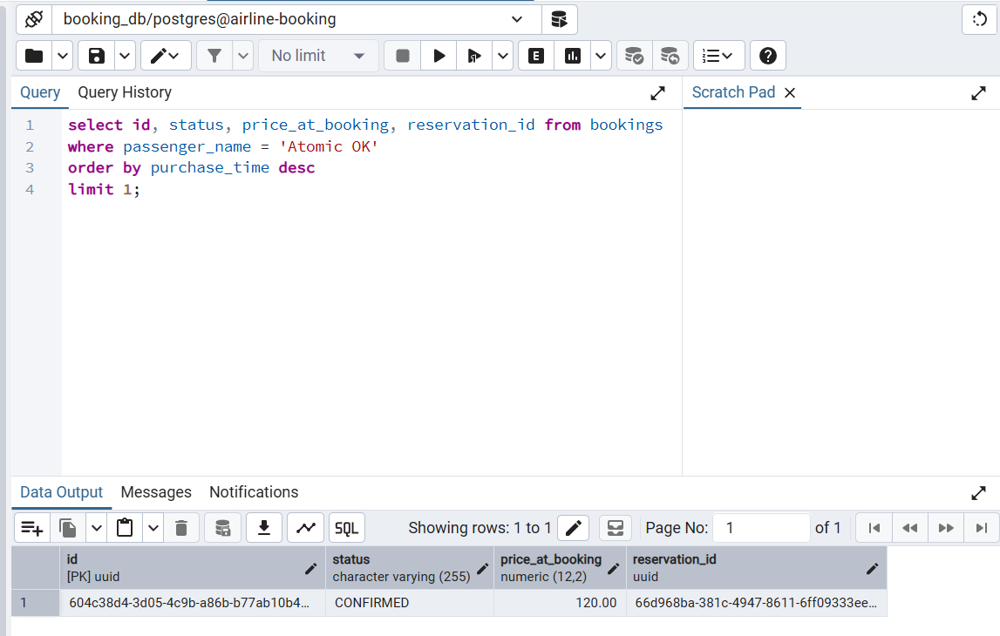

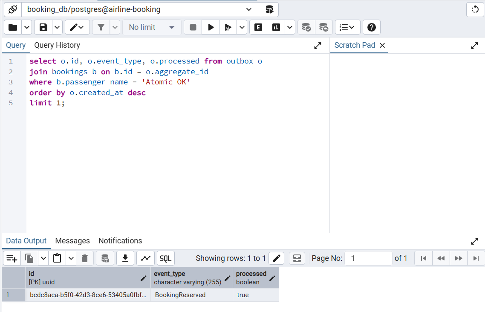

Збій:

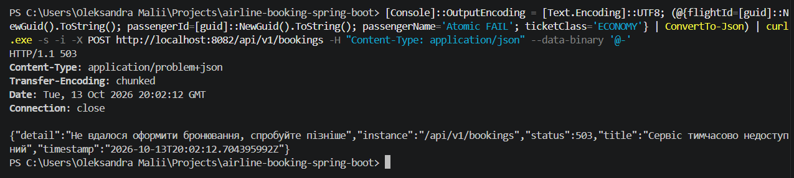

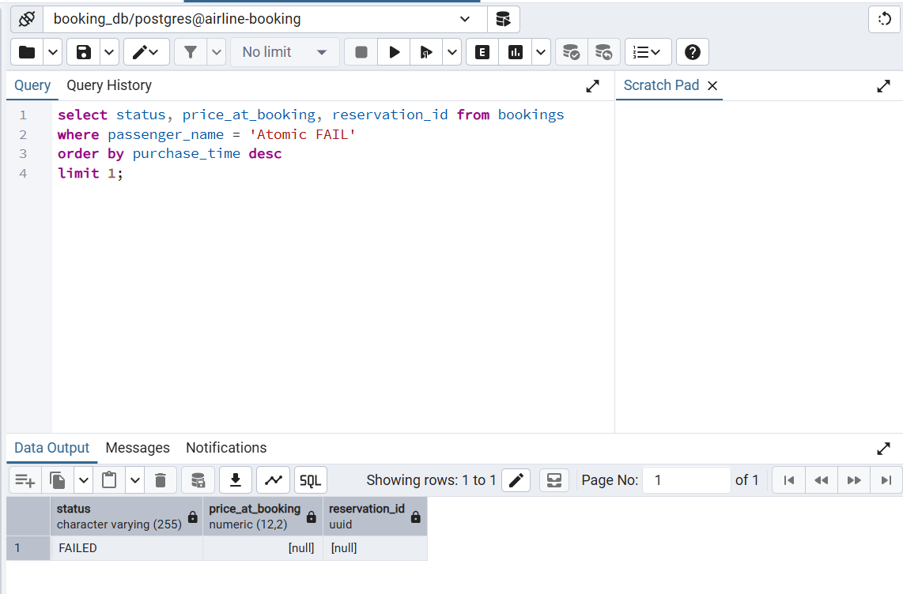

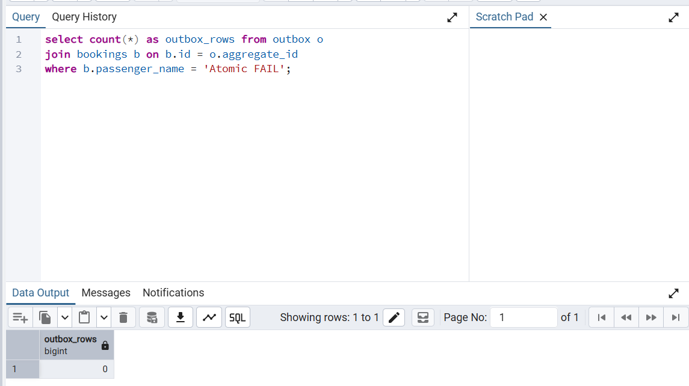

## 4. Інтеграційні тести з EmbeddedKafka

`payment-service`, `BookingReservedListenerTest` (4 тести, топік на 3 партиції):

| Тест | Що перевіряє |
|---|---|
| `eventIsDeliveredToPaymentService` | подія з `booking-events` доходить до сервісу |
| `transientFailureIsRetriedThenSentToDltWithFailedResult` | тимчасова помилка: 3 спроби, потім DLT і результат `FAILED` |
| `nonTransientFailureGoesStraightToDlt` | нетимчасова помилка йде в DLT без ретраїв |
| `malformedMessageDoesNotBlockFollowingEvents` | зламане повідомлення не блокує наступні |

`booking-service`, `PaymentProcessedListenerTest` (2 тести): доставка події та перехід у `payment-events-dlt` після 3 невдалих спроб (повідомлення читається з DLT тестовим споживачем). `PaymentResultServiceTest` (8 тестів) перевіряє компенсацію: `SUCCESS` дає `CONFIRMED`, `DECLINED` і `FAILED` звільняють місце один раз і дають `FAILED`, дублікати та вже завершені бронювання ігноруються.

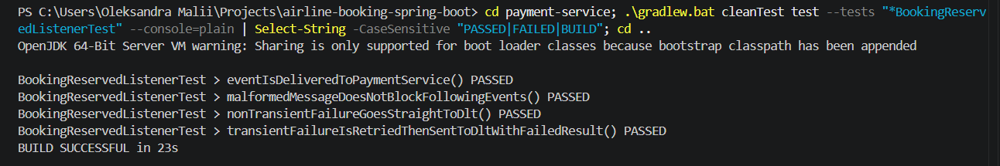

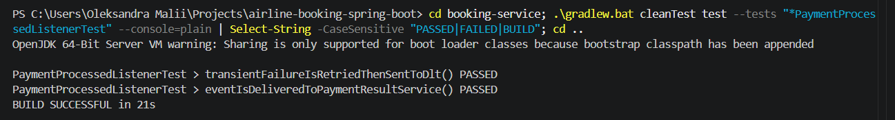

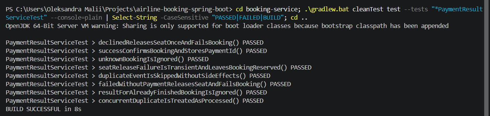

## 5. Експеримент зі штучною відмовою споживача

Налаштування `payment-service`: `payment.decline-probability=0`; `payment.consumer.failures-before-success` перші N обробок кидає тимчасову помилку до запису платежу.

### E1. Дві невдалі спроби, успіх із третьої (`failures-before-success=2`)

| Показник | Результат |
|---|---|
| Спроби обробки | 3: `booking-events` → `booking-events-retry-1000` → `booking-events-retry-2000` |
| Повідомлень у `retry-1000` / `retry-2000` / `booking-events-dlt` | 1 / 1 / 0 |
| Платежів `CHARGE` для бронювання | 1 (`SUCCESS`, 120.00) |
| Записів у `processed_events` | 1 |
| Результатів `PaymentProcessed` у `outbox` | 1 |
| Статус бронювання | `CONFIRMED` |

Спроби в логу `payment-service` (кожна наступна читається з наступного топіка):

```
2026-10-13T20:19:21.993Z  INFO 1 --- [payment-service] [ntainer#0-0-C-1] c.e.p.p.i.BookingReservedListener        : Received BookingReservedEvent key=b6b6ec8a-bcc4-413a-9b42-cbaf5d70b994 partition=1 offset=1 eventId=f0c8aa37-ec1e-4ce1-ad50-27b9b5f2c73c
2026-10-13T20:19:23.182Z  INFO 1 --- [payment-service] [etry-1000-0-C-1] c.e.p.p.i.BookingReservedListener        : Received BookingReservedEvent key=b6b6ec8a-bcc4-413a-9b42-cbaf5d70b994 partition=0 offset=0 eventId=f0c8aa37-ec1e-4ce1-ad50-27b9b5f2c73c
2026-10-13T20:19:25.190Z  INFO 1 --- [payment-service] [etry-2000-0-C-1] c.e.p.p.i.BookingReservedListener        : Received BookingReservedEvent key=b6b6ec8a-bcc4-413a-9b42-cbaf5d70b994 partition=0 offset=0 eventId=f0c8aa37-ec1e-4ce1-ad50-27b9b5f2c73c
```

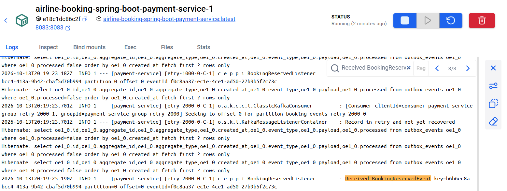

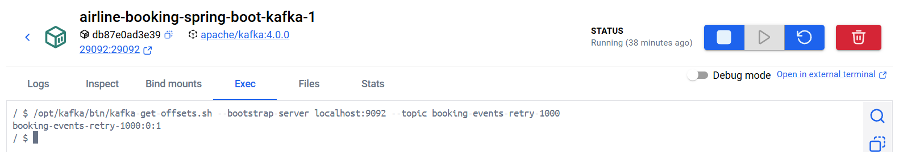

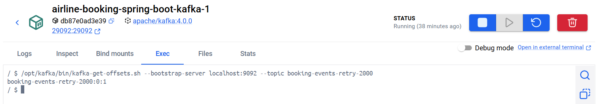

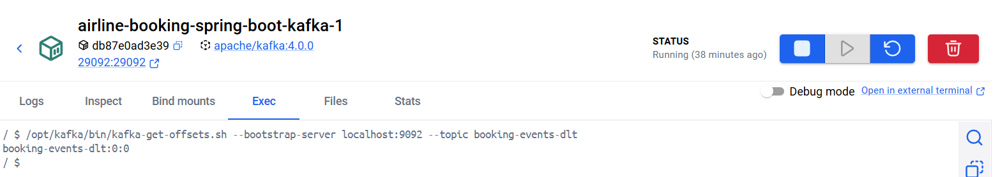

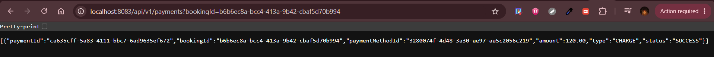

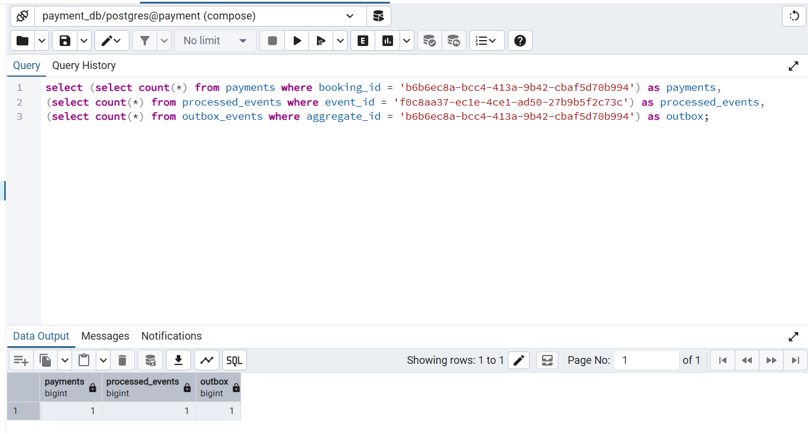

### E2. Повторна доставка тієї самої події (той самий `eventId`)

| Показник | До повтору | Після повтору |
|---|---|---|
| Платежів `CHARGE` для бронювання | 1 | 1 |
| Записів у `processed_events` | 1 | 1 |
| Результатів у `outbox` | 1 | 1 |
| Повідомлень для бронювання в `payment-events` | 1 | 1 |


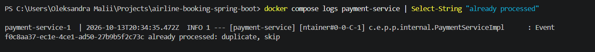

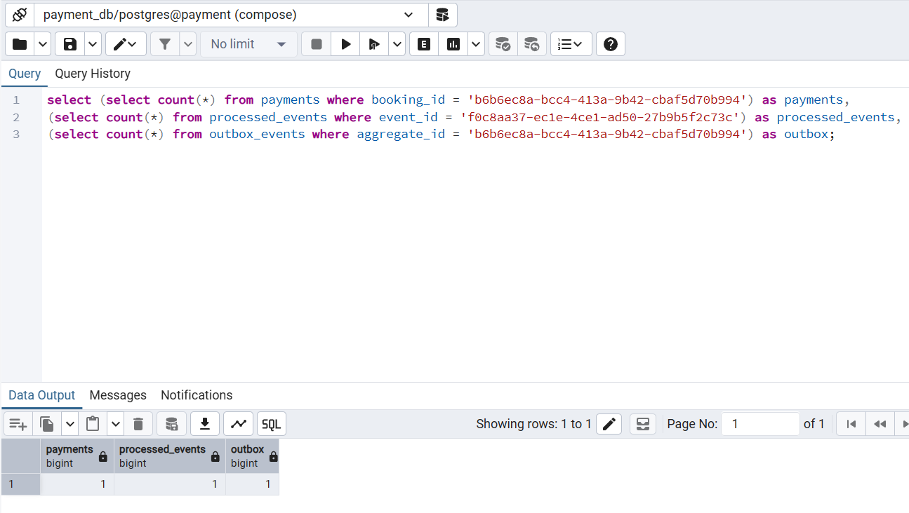

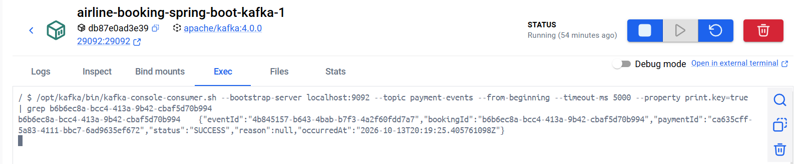

