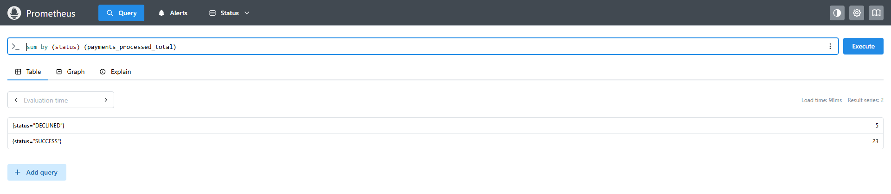
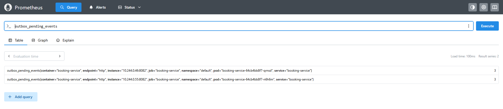
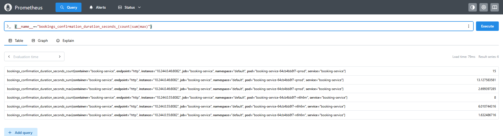
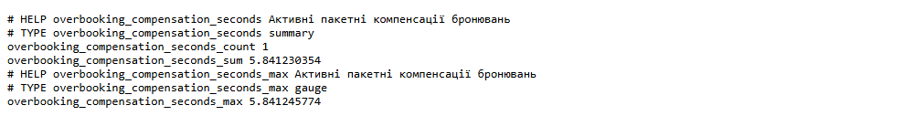
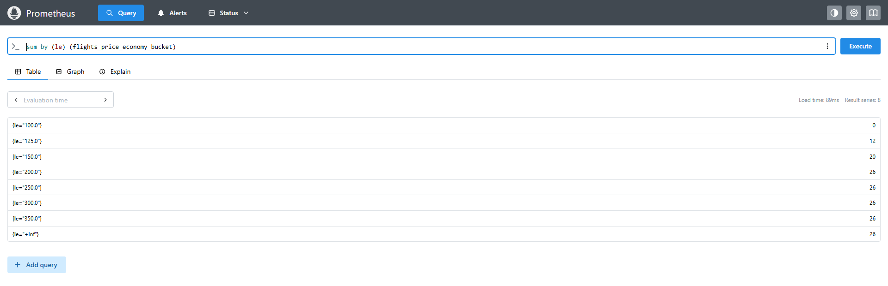
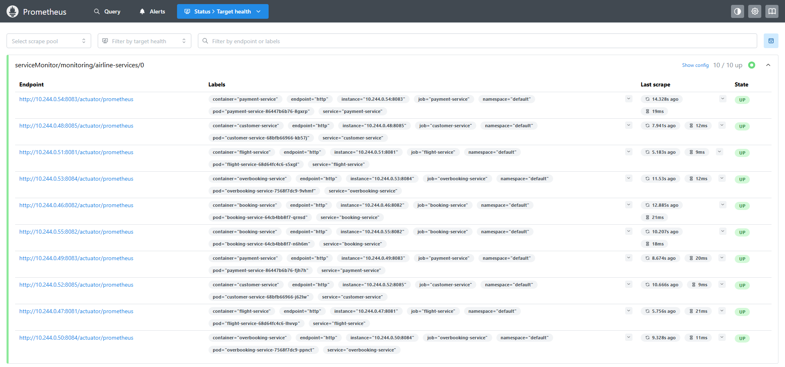
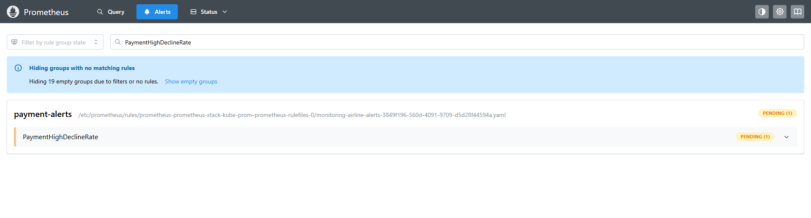
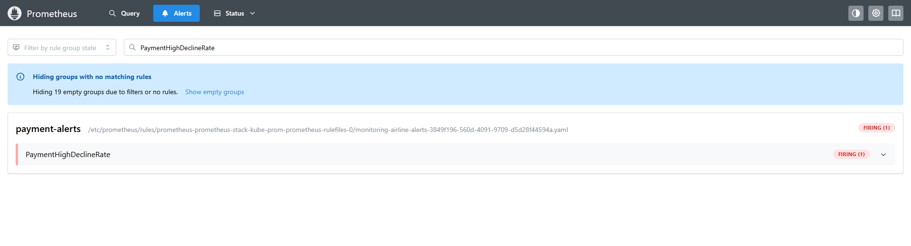
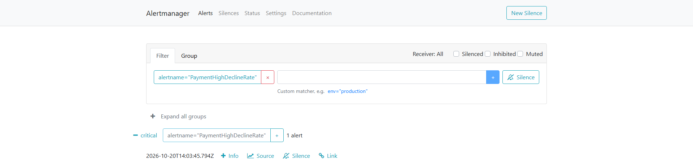

# Звіт: метрики, моніторинг і алертинг

## 1. Що зроблено

- У сервісах реалізовано метрики всіх п'яти типів Micrometer: Counter, Gauge, Timer, LongTaskTimer і DistributionSummary.
- У кластері Kubernetes розгорнуто Prometheus, Prometheus Operator і Alertmanager (Helm-чарт `kube-prometheus-stack`, реліз `prometheus-stack`, namespace `monitoring`).
- `ServiceMonitor` змушує Prometheus опитувати `/actuator/prometheus` усіх п'яти сервісів.
- Правило `PaymentHighDeclineRate` у Prometheus і маршрутизація в Alertmanager, перевірено перехід алерту в стан `Firing` під навантаженням.
- Kafka розгорнуто в кластері, щоб потік «бронювання → оплата → підтвердження» працював і породжував метрики.

## 2. Метрики

| Тип | Метрика | Сервіс | Де записується | Що показує |
|---|---|---|---|---|
| Counter | `payments.processed.total` (тег `status`) | `payment-service` | `PaymentServiceImpl.charge` | кількість оброблених платежів за результатом `SUCCESS` / `DECLINED` |
| Gauge | `outbox.pending.events` | `booking-service` | `PollingOutboxScheduler` | скільки подій outbox ще не відправлено в Kafka |
| Timer | `bookings.confirmation.duration` | `booking-service` | `PaymentResultServiceImpl.apply` | час від створення бронювання до підтвердження оплати |
| LongTaskTimer | `overbooking.compensation` | `overbooking-service` | `CompensationServiceImpl.compensate` | пакетна компенсація, що виконується зараз, і скільки вона вже триває |
| DistributionSummary | `flights.price.economy`, `flights.price.business` | `flight-service` | `FlightServiceImpl.calculatePrice` | розподіл розрахованих цін квитків у євро по класах |

Micrometer перетворює крапки на підкреслення, тому в Prometheus метрики мають вигляд `payments_processed_total`, `outbox_pending_events`, `bookings_confirmation_duration_seconds_*`, `overbooking_compensation_seconds_*`, `flights_price_economy_*`.

Для перевірки створено єдиний тестовий набір: три рейси з різними датами вильоту (через 40, 10 і 2 дні), пасажира й 28 бронювань (26 економ-класу й 2 бізнес-класу). Перед створенням набору сервіси й Prometheus було перезапущено, тому всі значення нижче належать саме цьому набору, а метрики читалися в Prometheus.

### Counter: `payments_processed_total`

Сума значень `SUCCESS` і `DECLINED` дорівнює кількості оброблених платежів (28 = 23 + 5) і збігається з кількістю створених бронювань, статуси рахуються окремо. Лічильник збільшується в кінці `charge()`, тому відкочена транзакція в нього не потрапляє.

### Gauge: `outbox_pending_events`

Kafka зупинено, створено 3 бронювання: значення зросло до 3 (кожна репліка рахує ту саму таблицю outbox), тобто події накопичилися. Після запуску Kafka планувальник відправив їх, і значення впало до `0`.

### Timer: `bookings_confirmation_duration_seconds`

`_count` дорівнює кількості підтверджених бронювань (23 = 15 + 8 за двома репліками, відповідає `SUCCESS` у лічильнику): відхилені платежі в Timer не потрапляють. Середній час підтвердження дорівнює `_sum / _count` (близько 0,8 с), найдовше підтвердження показує `_max` (понад 2,7 с у цьому наборі).

### LongTaskTimer: `overbooking_compensation_seconds`

Під час пакетної компенсації при недоступному `payment-service` рефанди йдуть через ретраї, і операція триває кілька секунд. Компенсація 8 бронювань тривала близько 14 с. Поки вона виконується, `_count` дорівнює `1`, а `_sum` зростає (на скріншоті близько 5,8 с); після завершення обидва значення повертаються до `0`. Prometheus опитує сервіс раз на 15 секунд, тому значення зняті прямо з `/actuator/prometheus` у момент виконання.

### DistributionSummary: `flights_price_economy`

Кожен розрахунок ціни потрапляє в один із бакетів `le` (межі в євро: 100, 125, 150, 200, 250, 300, 350). Значення бакетів накопичувальні. У цьому наборі 26 цін економ-класу: 12 до €125 (рейс через 40 днів), 20 до €150 (ще 8 з рейсу через 10 днів) і 26 до €200 (ще 6 з рейсу через 2 дні). Метрика бізнес-класу окрема, її межі інші (200 ... 750), бо ціни різного масштабу.

## 3. Збір метрик Prometheus

`ServiceMonitor` `airline-services` вибирає `Service` за міткою `app` зі списку п'яти сервісів і опитує порт `http`, шлях `/actuator/prometheus`, інтервал 15 с. Мітку `app` додано в `service.yaml` кожного сервісу. У кожного сервісу по дві репліки, тому цілей 10.

## 4. Алерт і Alertmanager

| Параметр | Значення |
|---|---|
| Алерт | `PaymentHighDeclineRate` |
| Умова | частка відхилених платежів `sum(rate(payments_processed_total{status="DECLINED"}[2m])) / sum(rate(payments_processed_total[2m]))` перевищує `0.3` |
| Витримка `for` | 1 хв |
| Критичність | `severity: critical` |
| Маршрутизація | алерти з `severity="critical"` потрапляють до отримувача `critical`; групування за `alertname` і `namespace`, `group_wait` 30 с, `repeat_interval` 4 год |

Штатна ймовірність відмови платежу в симуляції 10–15%, тому поріг 0,3 дає запас над нормою. Правило описано в `k8s/monitoring/prometheusrule.yaml`, маршрутизація в `k8s/monitoring/alertmanager-values.yaml`.

### Процес перевірки спрацювання

1. Для `payment-service` в кластері задано `PAYMENT_DECLINE_PROBABILITY=1.0`, тож усі платежі відхиляються (значення в маніфестах не змінювалося).
2. Запущено навантаження: бронювання через `POST /api/v1/bookings` кожні 3 секунди.
3. Лічильник `payments_processed_total{status="DECLINED"}` почав зростати, частка відхилених досягла `1.0`.
4. Алерт перейшов зі стану `Inactive` у `Pending`: умова виконується, але ще не тримається хвилину.
5. Приблизно через хвилину алерт перейшов у `Firing`.
6. В Alertmanager з'явився активний алерт `PaymentHighDeclineRate` із `severity=critical`, отримувач `critical`.
7. Після перевірки змінну `PAYMENT_DECLINE_PROBABILITY` прибрано, навантаження зупинено.

