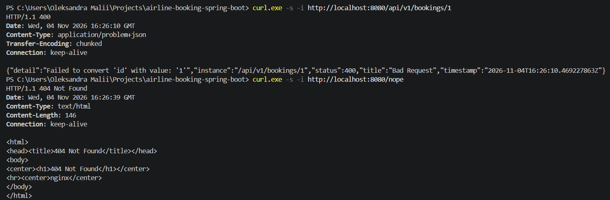
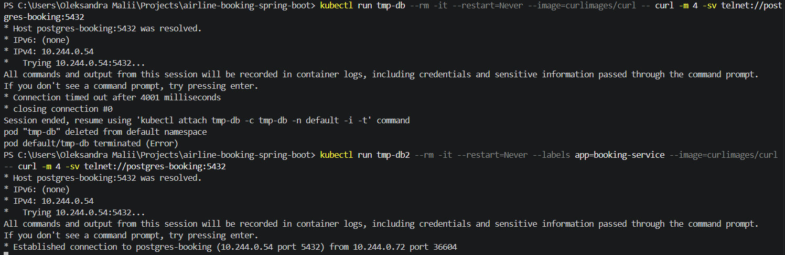
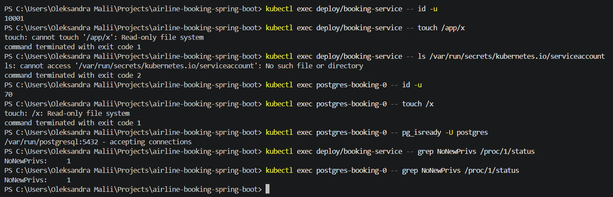

# Звіт: безпека кластера

## Що налаштовано

- Ingress до всіх п'яти сервісів: `k8s/ingress/ingress.yaml`.
- Заборона всього вхідного трафіку в `default`: `k8s/security/default-deny.yaml`.
- Сервіси приймають трафік тільки від Ingress, кожна база тільки від свого сервісу.
- Дозволи для зв'язків, які вже були (сервіс до сервісу, Kafka, трасування, логи, метрики), щоб система не зламалась.
- Поди працюють не від root, без підвищення привілеїв, з диском лише для читання і без токена ServiceAccount.

## Мапа дозволених зв'язків

Усе, чого немає в таблиці, заборонено. Ззовні кластера в систему можна потрапити тільки через Ingress.

| Хто звертається | До кого | Порт | Навіщо |
|---|---|---|---|
| Ingress-контролер | `customer-service` | 8085 | запити клієнтів |
| Ingress-контролер | `flight-service` | 8081 | запити клієнтів |
| Ingress-контролер | `booking-service` | 8082 | запити клієнтів |
| Ingress-контролер | `payment-service` | 8083 | запити клієнтів |
| Ingress-контролер | `overbooking-service` | 8084 | запити клієнтів |
| `booking-service` | `flight-service` | 8081 | місця і ціни |
| `booking-service` | `customer-service` | 8085 | пасажир і спосіб оплати |
| `overbooking-service` | `booking-service` | 8082 | бронювання для компенсації |
| `overbooking-service` | `payment-service` | 8083 | повернення грошей |
| кожен сервіс | своя база `postgres-<сервіс>` | 5432 | дані сервісу |
| `booking-service`, `payment-service` | `kafka` | 9092 | події бронювання й оплати |
| усі п'ять сервісів | `otel-collector` | 4318 | трейси |
| `otel-collector` | `tempo` | 4317 | збереження трейсів |
| `otel-log-agent` | `loki` | 3100 | збереження логів |
| Grafana | `tempo` | 3200 | показ трейсів |
| Grafana | `loki` | 3100 | показ логів |
| Prometheus | усі п'ять сервісів | порт сервісу | збір метрик |

## Ризики

| Що могло піти не так | Що це зупиняє |
|---|---|
| Зламаний под ходить до будь-якого іншого | Default Deny і дозволи тільки на потрібні зв'язки |
| Зламаний под підключається до чужої бази | база приймає з'єднання тільки від свого сервісу |
| Зовні видно службові адреси | в Ingress є лише шляхи `/api/v1/...` |
| Зловмисник у контейнері стає root або пише на диск | non-root, заборона ескалації, диск лише для читання |
| Зловмисник бере токен і йде в API кластера | токен ServiceAccount не монтується |

Що залишилось: трафік не шифрується, Ingress не перевіряє, хто стукає, а політики бачать лише адреси і порти, а не вміст запитів.

## Результати перевірки

Перевірено на версії з гілки `main` у кластері Docker Desktop.

### 1. Ingress передає запити сервісу

Запит на `/api/v1/bookings/1` через Ingress дійшов до `booking-service`: прийшла відповідь застосунку (JSON з помилкою). Неіснуючий шлях `/nope` отримав сторінку 404 від nginx.

### 2. Пряме підключення до бази заблоковано

Под без дозволеної мітки не підключився до `postgres-booking` (таймаут). Под з міткою `app: booking-service` підключився. Також заблоковані `customer-service` → `postgres-booking` і `flight-service` → `booking-service`, а всі потрібні зв'язки (сервіс → своя база, сервіс → сервіс, Kafka, колектор) працюють.

### 3. Поди запущені безпечно

| Перевірка | 5 сервісів | 5 баз |
|---|---|---|
| Користувач у поді | 10001 | 70 |
| Запис на диск контейнера | `Read-only file system` | `Read-only file system` |
| Токен ServiceAccount | немає | немає |
| Под `Ready`, перезапусків | 0 | 0 |

## Три збої і як їх виправити

**1. Default Deny без дозволів на наявні зв'язки.** Сервіси перестали бачити один одного, Kafka і колектор: `booking-service` не підключався до `flight-service`, `customer-service`, `kafka`, `otel-collector`. У логах колектора з'явилось 25 рядків з помилками за хвилину. Виправлення: додати дозволи (`networkpolicy-internal.yaml`, `k8s/kafka/networkpolicy.yaml`, `k8s/observability/networkpolicy.yaml`).

**2. Диск лише для читання без `/tmp`.** Под сервісу постійно перезапускався. У логах: `Unable to create tempDir ... Read-only file system`, бо Tomcat пише в `/tmp`. Виправлення: змонтувати `emptyDir` у `/tmp`.

**3. База не від root на новому диску.** Под бази падав з помилкою `initdb: could not change permissions of directory "/var/lib/postgresql/data": Operation not permitted`. Диск створює storage class `standard` (`rancher.io/local-path`), він не застосовує `fsGroup`, тому каталог належить root. Виправлення: storage class з підтримкою `fsGroup` або `initContainer`, який змінює власника каталогу на 70. На дисках, де база вже була створена, все працює.
