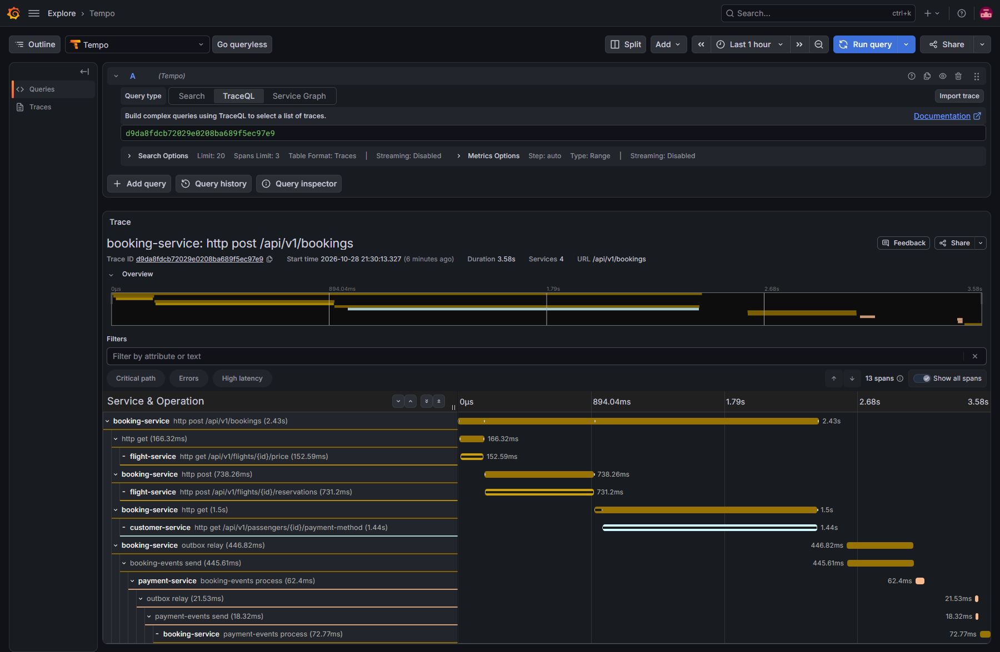
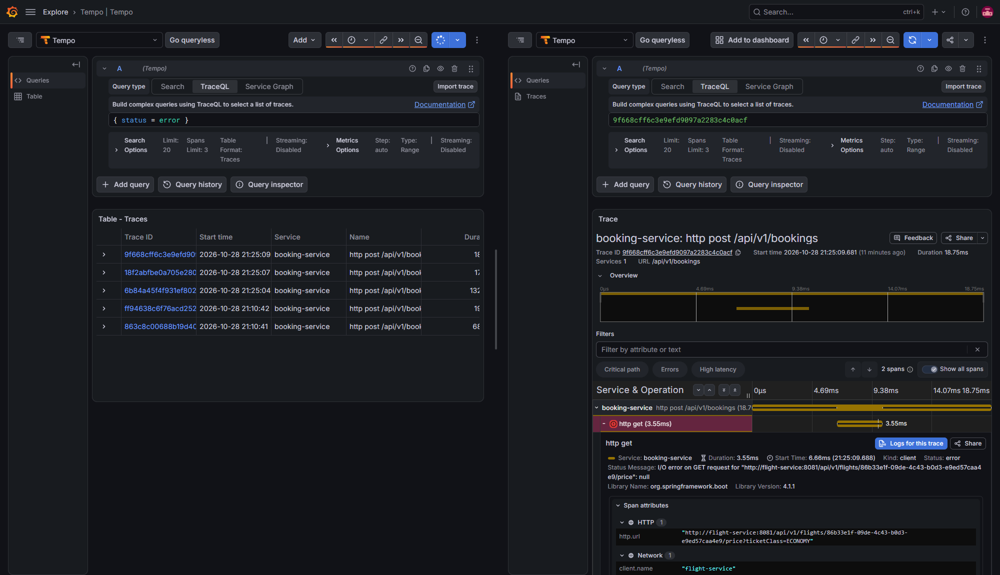
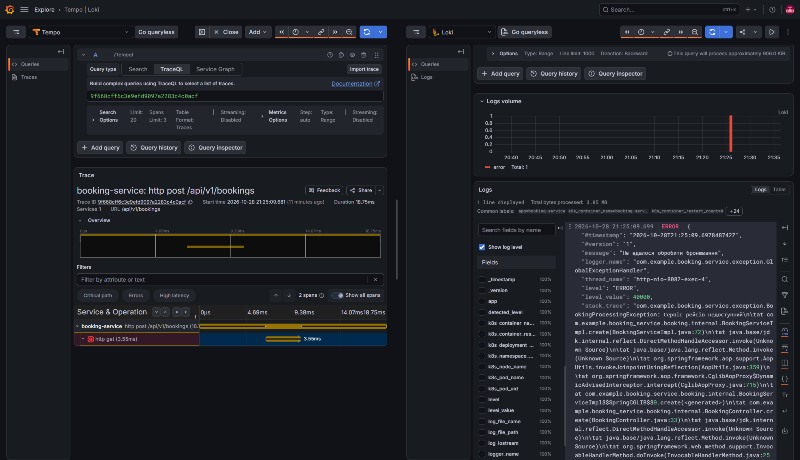
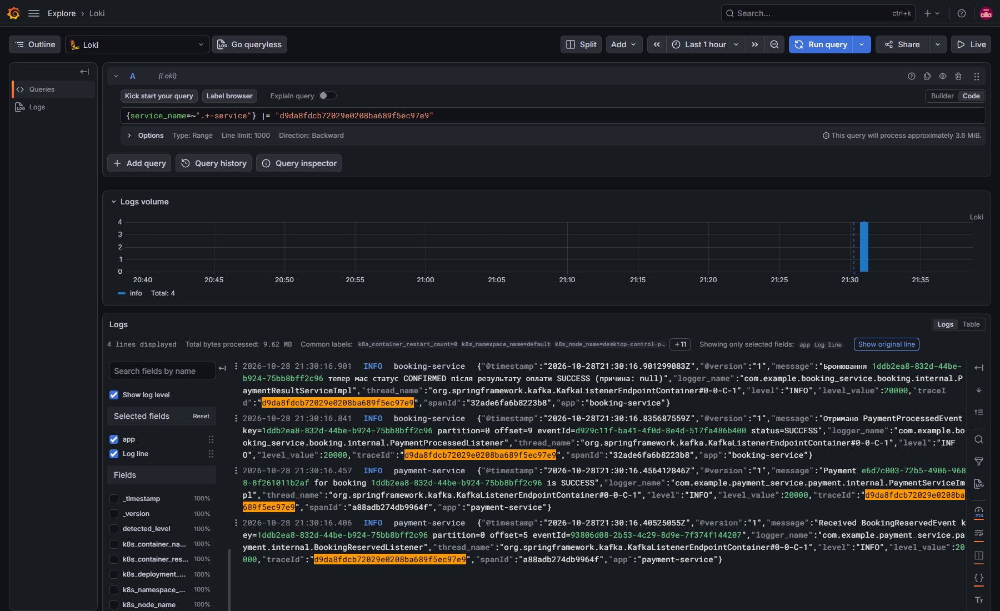
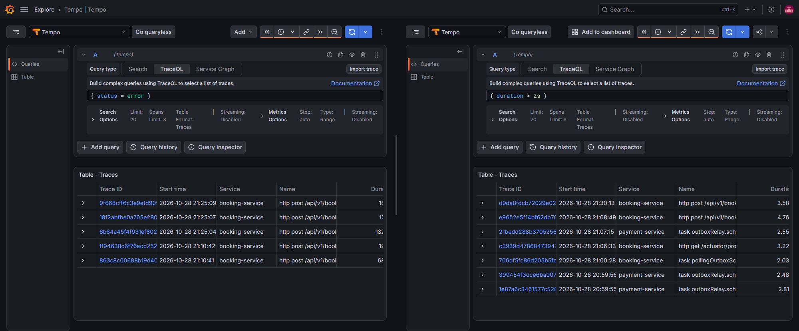

# Звіт: розподілене трасування та централізовані логи

## 1. Що зроблено

- У всіх п'яти сервісах підключено `spring-boot-starter-opentelemetry`: HTTP-запити, виклики через `RestClient` і повідомлення Kafka отримують спани, контекст передається в заголовку `traceparent`.
- Логи сервісів переведено у JSON (`logstash-logback-encoder`), у кожному записі є `app`, `traceId` і `spanId`.
- `traceparent` зберігається в outbox `booking-service` і `payment-service`, тому події, які відправляє планувальник, лишаються в трейсі запиту, а не починають новий.
- У кластері розгорнуто OpenTelemetry Collector з tail sampling, Grafana Tempo для трейсів, Grafana Loki для логів і агент логів (DaemonSet), який читає stdout подів і відправляє записи в Loki.
- У Grafana додано джерела Tempo і Loki з переходом від спана до логів і від рядка логу до трейса.
- Перевірено наскрізний трейс через три сервіси й Kafka, діагностичний цикл від трейса з помилкою до рядка логу та роботу семплінгу.

| Вимога | Де доведено |
|---|---|
| Трейс із трьома мікросервісами та Kafka в одному дереві | розділ 5 |
| JSON-логи сервісів зі спільним `traceId` | розділи 4 і 6 |
| Перехід спан, логи Loki | розділ 6 |
| Політики семплінгу колектора | розділи 2 і 7 |
| Архів із конфігураціями, маніфестами, звітом і скріншотами | розділ 8 |

## 2. OpenTelemetry Collector

Маніфести в `k8s/observability/otel-collector.yaml`: Deployment з однією реплікою образу `otel/opentelemetry-collector-contrib:0.163.1` і Service `otel-collector` з портами 4317 (gRPC) та 4318 (HTTP). Сервіси відправляють спани на `http://otel-collector:4318/v1/traces`, колектор експортує їх у `tempo:4317`.

Конвеєр `traces`: `otlp` приймач, процесори `memory_limiter`, `tail_sampling`, `batch`, експортер `otlp/tempo`. У сервісах `management.tracing.sampling.probability=1.0`, тобто вони відправляють усі спани, а рішення про збереження трейса ухвалює колектор, коли вже бачить весь трейс (`decision_wait: 10s`). Спани, що приходять після рішення, отримують його з `decision_cache`, тому трейс не розпадається на частини.

| Політика | Тип | Що робить |
|---|---|---|
| `keep-errors` | `status_code` | трейс зберігається повністю, якщо хоча б один спан має статус `ERROR` |
| `keep-slow-traces` | `latency` | трейс зберігається, якщо його тривалість перевищує 2000 мс |
| `keep-manual-bookings` | `string_attribute` | трейси з атрибутом `uri = /api/v1/bookings` зберігаються завжди, щоб ручні бронювання для демонстрації не випадали |
| `sample-successful` | `probabilistic` | решта швидких успішних трейсів зберігається з імовірністю 1% |

Політики об'єднуються через «або»: трейс зберігається, якщо його обрала будь-яка з них. Так Tempo отримує всі помилки й усі повільні запити, але не захаращується тисячами однакових успішних трейсів.

## 3. Схема взаємодії

```
customer-service  flight-service  booking-service  payment-service  overbooking-service
       |                |               |                |                  |
       |   спани OTLP/HTTP (4318)       |                |                  |
       +----------------+-------+-------+----------------+------------------+
                                |
                         otel-collector  (tail sampling)
                                |  OTLP/gRPC 4317
                              tempo

   stdout подів (JSON-рядки)  -->  otel-log-agent (DaemonSet, filelog)  -->  loki (OTLP 3100)

   grafana (namespace monitoring): джерело Tempo читає tempo:3200, джерело Loki читає loki:3100
```

| Компонент | Маніфест | Роль |
|---|---|---|
| `otel-collector` | `k8s/observability/otel-collector.yaml` | приймає спани від сервісів, семплює, відправляє в Tempo |
| `tempo` | `k8s/observability/tempo.yaml` | зберігає трейси (локальне сховище, PVC 1Gi), віддає їх Grafana на 3200 |
| `otel-log-agent` | `k8s/observability/otel-log-agent.yaml` | читає `/var/log/pods/*` п'яти сервісів, розбирає JSON, додає метадані Kubernetes, пише в Loki |
| `loki` | `k8s/observability/loki.yaml` | зберігає логи, мітка `service_name` дорівнює назві сервісу, `traceId` доступний як structured metadata |
| Grafana | `k8s/monitoring/grafana-values.yaml` | джерела Tempo і Loki, `tracesToLogsV2` і derived field `TraceID` |

Агент логів розбирає JSON-рядок оператором `json_parser`, а `trace_parser` переносить `traceId` і `spanId` у стандартні поля запису, тому Loki знає, до якого трейса належить рядок, без додаткових запитів.

## 4. Зміни в сервісах

| Зміна | Де | Навіщо |
|---|---|---|
| `spring-boot-starter-opentelemetry`, `management.tracing.sampling.probability=1.0`, `management.opentelemetry.tracing.export.otlp.endpoint` | `build.gradle`, `application.properties` усіх сервісів | спани HTTP і `RestClient`, експорт у колектор; адреса береться зі змінної `OTEL_TRACES_ENDPOINT` у ConfigMap |
| `management.otlp.metrics.export.enabled=false`, `management.logging.export.otlp.enabled=false` | `application.properties` усіх сервісів | метрики збирає Prometheus, логи агент зі stdout, тому OTLP для них не потрібен |
| `logstash-logback-encoder`, `logback-spring.xml` | усі сервіси | JSON-логи з `app`, `traceId`, `spanId`; `traceId` і `spanId` кладе в MDC Micrometer Tracing |
| `SPRING_JPA_SHOW_SQL: "false"` | ConfigMap кожного сервісу | SQL простим текстом ламав JSON-формат |
| `spring.kafka.template.observation-enabled=true`, `spring.kafka.listener.observation-enabled=true` | `booking-service`, `payment-service` | спани PRODUCER і CONSUMER для Kafka, `traceparent` у заголовках повідомлень |
| Колонка `traceparent` в outbox, клас `OutboxTracing` | `booking-service` (`OutboxRecord`, `BookingServiceImpl`, `PollingOutboxScheduler`), `payment-service` (`OutboxEvent`, `PaymentServiceImpl`, `OutboxRelay`) | подію відправляє планувальник через 500 мс без активного спана; збережений контекст відновлюється перед відправкою, і продюсерський спан стає дочірнім до запиту |

Без останнього пункту трейс розривався на два: HTTP-запит у `booking-service` і окремий трейс від планувальника outbox. Юніт-тест `OutboxTracingTest` на реальному OpenTelemetry SDK перевіряє, що записаний `traceparent` відновлюється з тим самим `traceId`.

## 5. Єдиний трейс

Виконано `POST /api/v1/bookings`. У Grafana (Explore, джерело Tempo, Search за `Service Name = booking-service`) трейс містить:

1. серверний спан `POST /api/v1/bookings` у `booking-service`;
2. клієнтські спани `RestClient` до `flight-service` (ціна й резервація місця) і `customer-service` (спосіб оплати) та відповідні серверні спани в цих сервісах;
3. спан `outbox relay` і спан PRODUCER `booking-events publish` у `booking-service`;
4. спан CONSUMER `booking-events process` у `payment-service`, далі `outbox relay` і PRODUCER `payment-events publish`;
5. спан CONSUMER `payment-events process` у `booking-service`, де бронювання переходить у `CONFIRMED`.

Усі спани мають один `traceId`, тобто три сервіси й два топіки Kafka видно в одному дереві.



## 6. Діагностичний цикл

1. `flight-service` зупинено: `kubectl scale deployment flight-service --replicas=0`.
2. Виконано кілька `POST /api/v1/bookings`; `booking-service` отримав помилку з'єднання, позначив бронювання як `FAILED` і повернув `503`.
3. Репліки `flight-service` повернуто.
4. У Tempo запитом TraceQL `{ status = error }` знайдено трейс із помилкою: спан `RestClient` до `flight-service` має статус `ERROR`.
5. На цьому спані натиснуто «Logs for this span»: Grafana відкрила Loki з рядками, у яких той самий `traceId`, зокрема рядок про недоступний сервіс рейсів.
6. Той самий результат дає пошук у Loki вручну: `{service_name=~".+-service"} |= "<traceId>"`.







## 7. Семплінг

Після серії звичайних бронювань і сценарію з розділу 6 перевірено, що колектор зберіг потрібні трейси:

- `{ status = error }` повертає трейси зі збоєм `flight-service` (політика `keep-errors`);
- `{ duration > 2s }` повертає повільні трейси, наприклад бронювання з ретраями під час відновлення `flight-service` (політика `keep-slow-traces`);
- звичайні швидкі бронювання теж є в Tempo, бо їх зберігає `keep-manual-bookings`; решта фонових запитів, наприклад `GET /api/v1/bookings/{id}`, потрапляє лише з імовірністю 1%.



## 8. Архів

Архів для здачі містить:

- маніфести `k8s/` разом із `k8s/observability/` і `k8s/monitoring/`;
- конфігурації колектора й агента логів (вбудовані в ConfigMap у тих самих маніфестах), `logback-spring.xml` і `application.properties` сервісів;
- цей звіт і скріншоти `docs/screenshots/tracing-*.png`.

Секрети в архів не входять: у `k8s/*/secret.yaml` лишаються лише демонстраційні значення для локального кластера.
